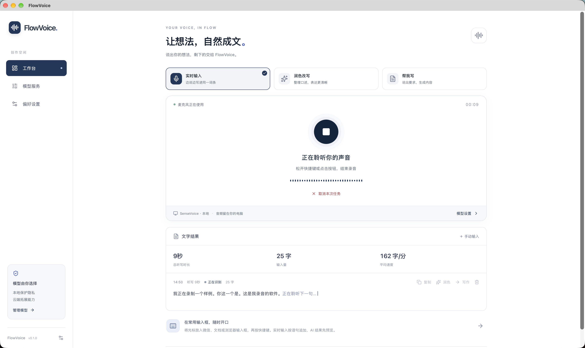
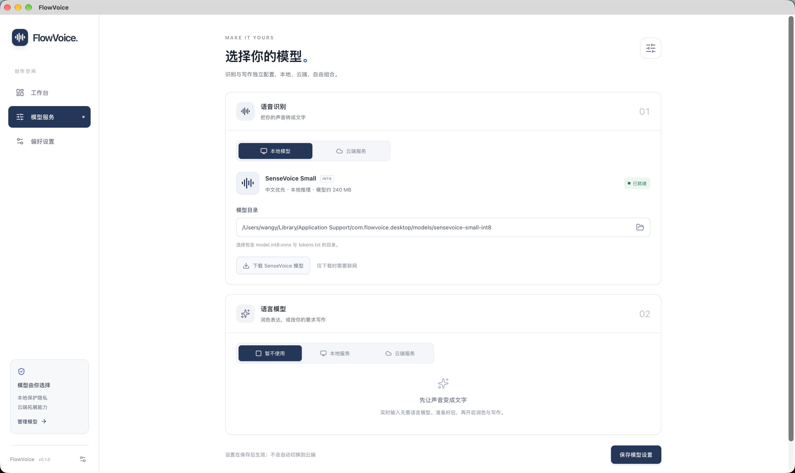
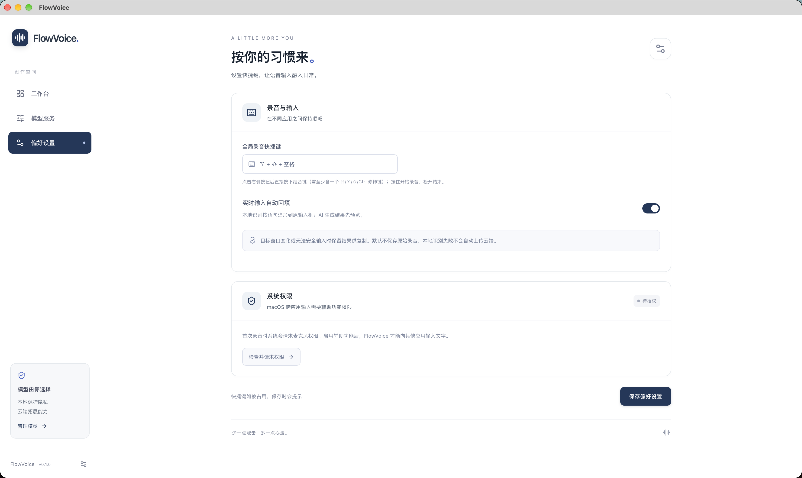

<div align="center">
  

  # FlowVoice · 语音转文字与 AI 写作

  **让想法，自然成文。**

  Windows / macOS 多语言桌面语音输入软件，支持简体中文、繁體中文、English，离线语音识别、实时语音转文字、AI 润色与内容生成。<br />
  基于 Rust + Tauri 2，本地 SenseVoice 模型与云端 OpenAI 兼容接口可自由组合。

  
  
  
  

</div>

## FlowVoice 是什么？

FlowVoice 是一款**中文语音输入、语音转文字（Speech-to-Text / STT）与 AI 写作软件**。它将「说话 → 实时转写 → 润色成稿」放在同一个桌面工作台中，支持 Windows 和 macOS。

你可以使用本地模型完成**离线语音识别（Offline Speech Recognition）**，不将录音上传云端；也可以独立接入兼容的云端转写服务、本地或云端大语言模型（LLM），完成 AI 文本润色、改写和内容生成。本地实时听写会将确认语句持续追加到同一词条，也可以增量输入到微信、文档或其他文本编辑器。

**English:** FlowVoice is a multilingual, local-first voice typing and AI writing desktop app for Windows and macOS. It supports Simplified Chinese, Traditional Chinese and English interfaces, real-time speech-to-text, offline Chinese speech recognition, text polishing and AI-assisted content generation. Built with Rust and Tauri, powered by SenseVoice and sherpa-onnx, with optional OpenAI-compatible ASR and LLM providers.

> 当前为 **v0.1.0 开发原型**，尚未发布安装包。Windows 已完成条件编译检查，仍需在 Windows 实机验收；macOS 已有可运行的本机调试包。项目未声明统一开源许可证，默认保留所有权利；第三方组件与模型遵循各自许可证。



## 已实现功能

- **全局语音输入（Voice Typing）**：按住快捷键说话，松开结束。Windows 默认 `Ctrl + Shift + Space`，macOS 默认 `Option + Shift + Space`，支持自定义组合键。
- **离线实时语音转文字（Real-time Transcription）**：通过 sherpa-onnx 使用 SenseVoice Small INT8；停顿后确认语句，持续追加到同一词条，并可增量写入原输入框。
- **本地模型与云端 API 自由组合**：本地 SenseVoice，OpenAI 兼容的 `/audio/transcriptions` 转写接口，以及本地或云端 `/chat/completions` 写作接口。
- **AI 润色与帮我写**：保留原始转写，结果先预览，再编辑、复制或回填。
- **多语言界面（Multilingual UI / i18n）**：在「偏好设置 → 外观与语言」切换简体中文、繁體中文或 English。桌面端立即保存并同步工作台、录音浮窗和系统托盘；旧版配置默认使用简体中文。界面语言不改变语音识别或 AI 输出语言。
- **跨平台桌面体验**：全局快捷键、录音浮窗、系统托盘，以及 Windows／macOS 对应的快捷键和权限界面。
- **保护你的数据**：默认不保存原始录音，本地识别失败不会自动改用云端；普通配置与 API Key 分开保存。

| 模型服务 | 偏好设置 |
| --- | --- |
|  |  |

## 快速开始

准备 [Node.js](https://nodejs.org/)、[pnpm](https://pnpm.io/installation)、[Rust](https://rustup.rs/)，以及对应平台的 [Tauri 2 系统依赖](https://v2.tauri.app/start/prerequisites/)。

```sh
git clone https://github.com/kobaw23214/FlowVoice.git
cd FlowVoice
pnpm install
pnpm tauri dev
```

Windows 需要 Microsoft C++ Build Tools、Windows SDK 和 WebView2；macOS 需要 Xcode Command Line Tools。首次使用请进入「模型服务」下载 SenseVoice 模型，或配置云端转写服务。模型文件需要单独下载，不包含在此仓库中。

`pnpm dev` 只预览网页界面，录音、全局快捷键和模型管理需在 Tauri 桌面应用中运行。

### 构建与测试

```sh
pnpm build
pnpm test
pnpm test:e2e
cargo test --manifest-path src-tauri/Cargo.toml
```

在本机构建安装包：

```sh
pnpm tauri build
```

Windows 上通过 PowerShell 运行。macOS 未加载 Rust 环境的终端可以先执行 `source "$HOME/.cargo/env"`。

## 技术栈

| 层级 | 实现 |
| --- | --- |
| 桌面与核心 | Rust、Tauri 2 |
| 前端 | Vite、React、TypeScript、Zustand、Tailwind CSS |
| 本地 ASR | sherpa-onnx、SenseVoice Small INT8 |
| 云端协议 | OpenAI 兼容转写与 Chat Completions 接口 |
| 凭据存储 | macOS 钥匙串、Windows 凭据管理器 |

## 搜索关键词

**中文**：语音转文字、语音输入软件、实时语音识别、离线语音识别、中文语音识别、本地语音模型、AI 语音输入、AI 写作、语音润色、多语言语音输入、繁体中文语音识别、国际化桌面应用、Windows 语音输入、Mac 语音转文字、Rust 桌面应用、Tauri 语音识别。

**English**: speech to text, voice typing, dictation software, offline speech recognition, real-time transcription, Chinese ASR, local-first voice input, multilingual voice typing, internationalization, i18n, Traditional Chinese, AI writing assistant, Windows voice typing, macOS dictation, Rust Tauri app, SenseVoice, sherpa-onnx, OpenAI-compatible API.

## 隐私与使用边界

选择本地 ASR 时，录音在你的电脑上处理；选择云端 ASR 或云端写作时，相应音频或文字会发送到你配置的服务。API Key 使用系统凭据存储，不写入普通设置 JSON 或浏览器存储。

自动输入会检查目标窗口，无法安全输入时保留结果供手动复制。应用不会自动发送 Enter。不同应用的焦点接口和输入行为存在差异，使用前请先在空白文档中测试。完整权限说明和验收边界见[原型使用与验收手册](docs/PROTOTYPE.md)。

## 文档

- [原型使用与验收手册](docs/PROTOTYPE.md)：模型配置、权限、运行限制与验收清单。
- [开发手册](docs/DEVELOPMENT_MANUAL.md)：架构、平台适配与开发约定。
- [本地模式专项调研](docs/research/offline-voice-input-2026-09-27.md)：本地模型与跨平台集成资料。

## 联系方式

欢迎交流 FlowVoice 的产品体验、使用问题与合作想法。

**邮箱：[1477746214@qq.com](mailto:1477746214@qq.com)**

**微信：扫码添加**


