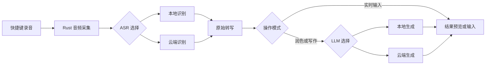

# FlowVoice 开发手册

首次编写：2026-09-27；最近更新：2026-11-08。本文记录产品定位、技术栈与长期开发约定。第一版开发原型已落地，实际运行方法与功能边界以[原型使用与验收手册](PROTOTYPE.md)为准；本文中尚未实现的目录拆分、选区替换、历史记录和流式能力仍是后续规划。

## 1. 产品定位

FlowVoice 是面向 **Windows 和 macOS** 的桌面语音输入与 AI 写作工具，对标闪电说的核心输入体验。

产品同时支持 **本地模型与多家云端模型**，由用户选择和配置。语音识别与文本生成分开选型，既能完全本地运行，也能采用本地与云端混合的方式。

核心能力：

1. **语音转文字**：全局快捷键录音，识别后将文字填入当前应用。
2. **AI 润色与写作**：整理口述内容，改写／扩写选中文字，或根据口述要求生成、续写内容。

首版将操作分成“实时输入”“润色改写”“帮我写”三个模式。实时输入可以绕过语言模型，生成和选区替换支持预览、取消及原文恢复。

### 模型组合

| 语音识别 ASR | 文本处理 LLM | 数据流与用途 |
| --- | --- | --- |
| 本地 | 本地 | 完整离线模式；模型准备完成后，音频与正文均在本机处理 |
| 本地 | 云端 | 音频在本机识别，转写文本及用户提供的写作上下文发送到所选云端服务 |
| 云端 | 本地 | 音频发送到所选云端识别服务，返回文字后在本机润色／生成 |
| 云端 | 云端 | 分别使用所选识别服务和语言模型；两者可以来自不同厂商 |

“支持本地”是产品能力，不代表每种配置都不上传数据。界面应明确显示当前 ASR、LLM 的运行位置与服务名称。

## 2. 已确定的起步技术栈

**具体起步组合直接参考 Handy：Vite + React + TypeScript（create-tauri-app 官方模板）+ Zustand 管状态 + Tailwind CSS 管样式，UI 组件按需使用 shadcn/ui 或手写。桌面壳与核心逻辑使用 Tauri 2 + Rust。**

| 层级 | 选型 | 约定 |
| --- | --- | --- |
| 桌面框架 | Tauri 2 | Windows、macOS 共用核心，系统差异放平台适配层 |
| 核心语言 | Rust | 录音、模型调用、文件与密钥管理、快捷键、输入回填 |
| 项目模板 | create-tauri-app 官方 React + TypeScript 模板 | 使用模板自带的 Vite 配置作为起点 |
| 前端构建 | Vite | 开发服务器与生产静态资源构建 |
| UI | React + TypeScript | 设置页、模型管理、录音浮窗、结果预览 |
| 状态管理 | Zustand | 前端共享状态、后端任务状态的展示与同步 |
| 样式 | Tailwind CSS | 统一主题、间距、字体、颜色和组件状态 |
| 基础组件 | shadcn/ui 或手写 | 按需引入；不强制一次性安装整套组件 |
| 包管理 | pnpm，作为起步约定 | 提交 pnpm-lock.yaml；Rust 提交 Cargo.lock |

Handy 的依赖文件可核实 React、TypeScript、Vite、Zustand 和 Tailwind 的组合；shadcn/ui 是本项目的可选组件方案，不将其说成 Handy 的既有依赖。参考它的技术组合与实现经验，项目仍由官方模板初始化。[Handy package.json](https://github.com/cjpais/Handy/blob/main/package.json)、[Tauri 官方建项文档](https://v2.tauri.app/start/create-project/)

版本在实际初始化时选择相互兼容的稳定版本并锁定，不照搬 Handy 某次提交的全部版本号、依赖和脚本。Rust 是核心开发语言，前端使用 TypeScript，底层推理库允许通过 Rust 绑定或子进程接入 C/C++ 引擎。

### 当前界面视觉规范

工作台采用 **白色 + Navy / Slate 中性色**，主色为 `#253858`，悬停与录音状态为 `#14243a`。页面、侧栏和主要卡片使用白色，浅中性灰只用于辅助分区。主按钮、当前导航和分段选择器使用深色背景与白色文字；品牌蓝仅保留在少量标识和状态提示中，普通图标使用灰蓝色，不为每个功能分配不同颜色。

正文与辅助说明必须保持足够对比度，不用低对比的彩色文字承担关键说明。后续新增组件沿用这套层级，参考 [Radix Themes 色彩语义](https://www.radix-ui.com/themes/docs/theme/color)、[shadcn/ui Dashboard](https://ui.shadcn.com/examples/dashboard) 与 [React Spectrum](https://react-spectrum.adobe.com/react-spectrum/index.html)，不以引入更多颜色作为区分功能的手段。

### 平台输入与图标约定

快捷键的录制、注册与显示按平台区分：Windows 默认 `Ctrl + Shift + Space`，macOS 默认 `Option + Shift + Space`。Windows 显示 `Ctrl / Alt / Shift / Win`，macOS 显示 `⌃ / ⌥ / ⇧ / ⌘`。录制用户实际按下的修饰键，使用全局快捷键插件可解析的 `Control`、`Super`、`Alt`、`Shift`；不把 macOS 的 Command 映射带进 Windows 的 Ctrl。只迁移原始默认值，不覆盖用户自定义组合。

应用资源使用统一的 FlowVoice 深墨色声波标识。源文件为 `src-tauri/icons/flowvoice.svg`，通过 `pnpm tauri icon src-tauri/icons/flowvoice.svg --output src-tauri/icons` 生成 Windows `.ico`、macOS `.icns` 和各尺寸 PNG；不得继续使用 Tauri 模板的黄蓝默认图标。Windows 开始菜单等 Appx 资源也已同步生成。

Windows 的原生开发与发布在 Windows 机器上进行。安装 Microsoft C++ Build Tools、Windows SDK、WebView2、Node.js、pnpm 与 Rust 的 `x86_64-pc-windows-msvc` 工具链后，在 PowerShell 的项目根目录执行 `pnpm install`、`pnpm tauri dev`；需要安装包时执行 `pnpm tauri build`。Windows 专属输入实现位于 `src-tauri/src/platform.rs`，包括前台窗口与聚焦控件核对，以及 `SendInput` Unicode 输入；macOS 专属辅助功能与 CGEvent 实现在同一文件的条件编译模块中。

Mac 上可以用 `rustup target add x86_64-pc-windows-gnu`、安装 MinGW-w64，再执行 `cargo check --manifest-path src-tauri/Cargo.toml --target x86_64-pc-windows-gnu` 检查 Windows 条件编译代码。这只用于开发阶段发现类型与依赖错误，不生成可验收的 Windows 安装包，也不代替 MSVC 原生构建、代码签名或 Windows 实机测试。

## 3. 初始化步骤

仓库已经使用官方 React + TypeScript 模板完成初始化，现有项目直接执行 `pnpm install` 与 `pnpm tauri dev`。以下保留建项方法供复现，不要在当前目录重新生成模板。平台准备参考 [Tauri 环境要求](https://v2.tauri.app/start/prerequisites/)。

在空的工作目录中生成模板，之后将生成文件合并到现有 FlowVoice 仓库并保留已有 docs；不要直接覆盖已有内容。

```sh
pnpm create tauri-app
```

向导选择：项目名 flowvoice；前端语言 TypeScript / JavaScript；包管理器 pnpm；UI 模板 React；UI flavor TypeScript。应用标识使用项目自己的唯一标识。

```sh
cd flowvoice
pnpm install
pnpm add zustand
pnpm add -D tailwindcss @tailwindcss/vite
```

Tailwind 起步使用 v4 的 Vite 插件方式：在现有 vite.config.ts 中追加 tailwindcss()，保留 React 插件和 Tauri 模板的开发服务器配置；在应用入口引用的 CSS 文件中加入：

```css
@import "tailwindcss";
```

无需再生成一套独立 Vite 项目。不要把 Tailwind v3 的初始化教程混入 v4 配置。[Tailwind 官方 Vite 接入说明](https://tailwindcss.com/docs/installation/using-vite)

需要 shadcn/ui 时，再按其 Vite 指南配置路径别名、主题并添加需要的组件。简单布局和录音状态控件可以手写，Dialog、Select 等交互较复杂的组件优先复用成熟实现。[shadcn/ui Vite 指南](https://ui.shadcn.com/docs/installation/vite)

完成后运行：

```sh
pnpm tauri dev
```

## 4. 前端与 Rust 的职责

### React、Zustand 与 Tailwind

React 负责交互和展示；Zustand 保存跨组件使用的状态；Tailwind 与组件层定义统一视觉规范。

建议按职责拆分 store：

- sessionStore：当前任务 ID、录音／识别／生成阶段、转写结果、生成预览、错误状态。
- settingsStore：快捷键展示、输入模式、语言、主题等非敏感配置。
- modelStore：服务商与模型列表、当前选择、下载进度、连接检查结果。

单个控件的展开状态、未提交表单等优先使用 React 局部状态。录音设备、音频缓冲和模型实例由 Rust 持有，不塞入 Zustand。

Rust 是录音和推理任务的状态权威。前端通过命令发起操作，通过事件或 channel 接收进度；多个窗口各有自己的 Zustand 实例，必须从 Rust 读取快照并订阅更新，不能假定天然共享内存。

持久化配置由 Rust 统一保存，前端载入与提交。API Key 不存入 Zustand 持久化、localStorage 或日志；密钥输入表单提交给 Rust 后清除，前端仅保留“已配置”等状态。[Zustand 官方仓库](https://github.com/pmndrs/zustand)

### Rust 核心

Rust 负责以下模块：

- AudioCapture：麦克风、音频格式、重采样、录音生命周期。
- AsrProvider：本地或云端语音识别。
- LlmProvider：本地或云端润色、扩写与生成。
- SessionManager：任务 ID、模式、取消、超时及结果归属。
- InputInjector：macOS／Windows 的焦点、选区、粘贴与恢复。
- ModelManager：本地模型下载、导入、校验、加载与卸载。
- ProviderRegistry：服务配置、能力声明、模型选择与连接检查。
- CredentialStore：通过系统凭据存储保存用户密钥。

前端不直接调用模型厂商 API。调用统一从 Rust 发出，集中处理鉴权、网络错误、流式结果和取消；本地推理放专用线程或 worker，避免阻塞录音和 UI。

## 5. 本地与云端模型接入约定

ASR 和 LLM 分别建立 Provider 接口。上层流程只依赖统一输入、结果和任务事件，厂商协议差异留在具体适配器内部。

### 本地模型

- ASR 起步候选：sherpa-onnx + SenseVoice-small INT8；Qwen3-ASR-0.6B 作为对照。
- LLM 起步候选：llama.cpp + Qwen 系列 GGUF，具体默认模型由目标电脑实测决定。
- 当前原型先接入用户自行启动的本地兼容 LLM 服务；内嵌引擎、GGUF 下载与服务进程托管尚未实现。本机回环地址与远程地址在界面中区分。
- 纯云端用户不必下载本地权重；本地用户可通过下载或离线导入准备模型。

本地引擎和模型的详细证据、许可证及硬件验证方案见[本地模式专项调研](research/offline-voice-input-2026-09-27.md)。

### 云端模型

“可接入各种云端模型”通过两类适配实现：

1. **通用兼容协议适配器**：优先为 LLM 支持 OpenAI-compatible Chat Completions 风格接口，允许配置 Base URL、模型 ID 和凭据。
2. **厂商专用适配器**：处理非兼容接口，以及云端 ASR 的 WebSocket、音频编码、鉴权与结束信号等差异。

支持某种兼容接口不等于兼容该厂商所有能力。模型列表接口、流式格式、参数、上下文限制与错误结构都需要按服务验证；不能承诺只填一个 API Key 就接入任意模型。具体首批云端厂商尚未确定。

服务配置至少包括：配置 ID、显示名称、用途（ASR／LLM）、运行位置、协议类型、Base URL、模型 ID、凭据引用、超时与模型参数。凭据引用与真实密钥分开存储。

能力声明至少区分：整段识别、原生流式识别、分段识别、文本流式输出、支持的音频格式和语言。UI 根据能力开放选项，避免把统一接口误当成所有模型能力相同。

每次录音开始时固定本次 ASR／LLM 配置，运行中更改设置仅影响后续任务。所有进度携带任务 ID 与递增事件序号，取消或新任务开始后丢弃旧结果；同一任务内也不能让迟到的半句事件覆盖最终文字。停止录音先进入最终识别阶段，只接受剩余确认语句；取消会移除当前未完成的实时词条，失败保留已经确认的文字。云端超时保留已获得的原始转写；避免无条件重试导致重复请求或重复计费。

## 6. 使用流程与数据边界



只向当前步骤所选的服务发送必要数据：云端 ASR 接收音频，云端 LLM 接收转写和用户主动提供的上下文。默认不保存原始音频，历史记录可关闭、删除。

本地失败时不自动上传云端。若以后提供回退功能，由用户明确配置目标服务与数据范围。选择“完全本地”后，识别和写作链路不发起外部模型请求；模型下载与更新作为独立操作。

浮窗与工作台显示中间结果，本地实时输入的外部应用按确认语句追加；通用云端 ASR 没有流式能力时，仍只发送最终文字。跨应用回填复用同一套平台适配，不随本地／云端选型重复实现。

## 7. 建议目录结构

以下为后续拆分规划。当前原型以 `src/App.tsx`、`src/stores/appStore.ts` 和 `src-tauri/src/` 下的 `audio.rs`、`providers.rs`、`session.rs`、`platform.rs`、`models.rs`、`storage.rs` 实现；按复杂度逐步拆分，避免为了目录结构提前增加抽象：

```text
src/
  components/ui/       基础组件，shadcn/ui 或手写
  features/recording/  录音浮窗与状态
  features/editor/     结果预览、改写与生成
  features/models/     本地模型与云端服务配置
  features/settings/   快捷键、语言、历史设置
  stores/              Zustand stores
  lib/tauri/           Rust 命令与事件封装
  types/               前后端通信类型
  styles/              Tailwind 入口与主题
src-tauri/src/
  commands/            Tauri 命令入口
  audio/               录音与预处理
  session/             任务状态机
  providers/asr/       本地与云端 ASR 适配
  providers/llm/       本地与云端 LLM 适配
  models/              本地模型管理
  platform/            Windows、macOS 输入与权限适配
  storage/             配置、历史与凭据
docs/
  DEVELOPMENT_MANUAL.md
  research/
```

## 8. 起步实现顺序

1. 用已确定的前端组合搭好 Tauri 外壳，完成设置页、浮窗和 Rust 状态同步。
2. 跑通快捷键 → 录音 → 本地 ASR → 原应用回填。
3. 在统一 LLM 接口下接通一种云端兼容服务和一个本地模型，实现润色与指令写作。
4. 接通一种云端 ASR，验证四种 ASR／LLM 组合及服务配置切换。
5. 补齐模型导入下载、密钥管理、取消超时、跨应用兼容、签名与安装。
6. 按实际用户需要新增厂商适配器，并公布经过验证的服务与能力清单。

MVP 验收同时覆盖本地断网运行和云端调用；重点验证取消后不误回填、切换窗口不误输入、密钥不出现在持久化前端状态中、云端失败不丢转写。准确率、速度和最低硬件要求以实测为准。

当前已提供上述 1—5 项中的原型代码：本地 ASR、通用兼容 ASR／LLM 接口、下载与导入、系统凭据存储、取消、快捷键和输入适配。接下来优先完成真实麦克风与外部编辑器验收、配置真实云端服务验证，以及 Windows 整应用构建与运行。签名、安装发布和更多厂商协议仍未完成。
