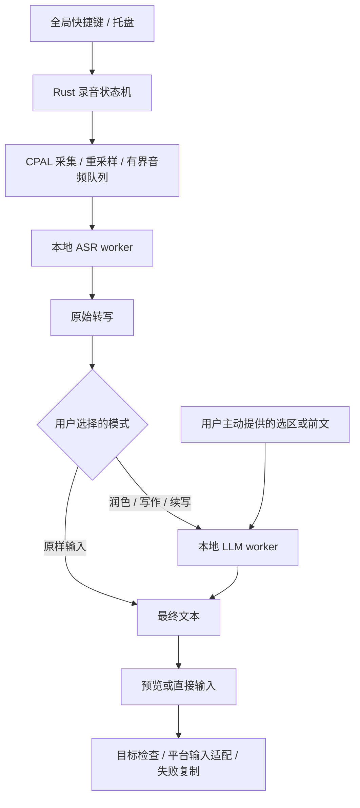

# FlowVoice：本地模式语音输入与 AI 写作专项调研

> 当前产品定位：FlowVoice 同时支持本地模型和多种云端模型。本文保留本地模式的专项技术证据，不代表全产品仅支持离线；当前架构、功能范围与开发顺序以 [开发手册](../DEVELOPMENT_MANUAL.md) 为准。

调研日期：2026-09-27。目标平台：Windows、macOS。本文研究本地模式下的离线语音识别、润色和生成，要求音频与相关文本在本机处理。当前 UI 起步栈已确定为 create-tauri-app 官方 Vite + React + TypeScript、Zustand、Tailwind，shadcn/ui 或手写组件按需使用。

本文基于产品官网、模型卡、官方源码与 API 文档。没有安装闪电说进行抓包，也没有下载模型进行整机实测。下文的硬件档位、时间安排和产品设计是工程建议，不是已经达到的性能指标。

## 1. 结论与建议选型

可以用 Rust 做，本地模式的首轮验证路线建议采用 **Rust 核心 + Tauri 2 + sherpa-onnx 本地 ASR + llama.cpp 本地 LLM**；具体落地选型以当前开发手册为准。

先做能在其他应用中使用的桌面语音助手：全局快捷键录音，识别后将最终文字填回当前输入框。第一版不必实现完整的系统输入法框架。

| 模块 | 首轮推荐 | 选择理由与边界 |
| --- | --- | --- |
| 主程序 | Rust + Tauri 2 | Rust 管理录音、权限、状态机、模型与系统输入；设置界面使用 WebView |
| 音频采集 | CPAL | 从设备采集音频，按模型要求重采样；推理不放在音频回调中 |
| 语音识别 | SenseVoice-small INT8，经 sherpa-onnx 调用 | 作为中文优先的基线；同时对比 Qwen3-ASR-0.6B 的 ONNX 版本 |
| 润色和写作 | Qwen3-4B-Instruct-2507 的 Q4 GGUF + llama.cpp | 作为首轮非思考模型基线；另测 Qwen3.5-4B 关闭思考后的质量与延迟 |
| 系统输入 | macOS / Windows 独立适配层 | 管理目标焦点、整段粘贴、剪贴板保护、失败后复制结果 |
| 本地存储 | 设置文件；按需启用本地历史数据库 | 默认不保存原始音频；历史可关闭、删除 |
| 分发 | 签名安装包 + 可导入模型包 | 提供完整离线安装渠道，用户无需安装 Python 或另起模型服务 |

Tauri 官方明确区分 Rust 核心和 WebView 界面；sherpa-onnx 提供包装 C API 的 Rust 接口；llama.cpp 是 C/C++ 引擎。因此这条路线是**用 Rust 开发产品核心，调用成熟原生推理库**，不是所有依赖都用 Rust 编写。[Tauri 进程模型](https://v2.tauri.app/concept/process-model/)、[sherpa-onnx Rust API](https://docs.rs/sherpa-onnx/1.13.8/sherpa_onnx/)、[llama.cpp](https://github.com/ggml-org/llama.cpp)

## 2. 对标闪电说：应该借鉴什么

闪电说目前已覆盖 Windows 和 macOS。官网文档将模型拆成 ASR、快速大模型、高级大模型，分别承担识别、整理和更复杂的理解与生成。它的范围已经超过用户提出的两个功能，延伸到读屏、记忆和技能执行。[下载页](https://shandianshuo.cn/download)、[模型说明](https://shandianshuo.cn/docs/beginner/model)

最值得借鉴的是一条短路径：在正在使用的应用中唤起，直接说话，然后得到可用文字；编辑既有内容时，选中文字再口述修改要求。[入门指南](https://shandianshuo.cn/docs)

需要区分其“支持本地模型”和“所有功能默认离线”：官方提供 SenseVoice-small 本地语音模型，但隐私说明明确表示，大模型功能是否离线取决于连接的是本地模型还是在线服务。自填云端 API Key 也仍然会向该服务发送数据。[本地语音模型安装](https://shandianshuo.cn/docs/faq/local-speech-model-install)、[隐私说明](https://shandianshuo.cn/privacy-first)

因此 FlowVoice 的本地模式可以形成一个明确的使用承诺：**选择本地 ASR 与本地 LLM、模型准备完成后，断网仍能完成语音识别、润色、内容生成和输入；音频、转写文本、选中的上下文均在本机处理。**是否兑现，要用断网测试和网络请求检查验证。云端模式的数据处理边界另见当前开发手册。

## 3. 两项功能应如何拆分

底层是 ASR 和 LLM 两个能力，界面上建议提供三个清楚的使用模式，避免模型猜错用户是在口述正文还是下命令。

| 模式 | 用户示例 | 预期行为 |
| --- | --- | --- |
| 原样输入 | “明天下午三点开会，记得带方案。” | 转成文字；允许基础标点和数字规范化，不擅自扩写 |
| 整理／润色 | 口述一段含重复、停顿的话；或选中文字说“简洁一点” | 去口头语、整理语序、改变指定语气，保留原意 |
| 帮我写／续写 | “帮我写一封请假邮件，周五请一天假，语气礼貌。” | 将口述内容当作写作要求，生成正文；续写还需用户提供前文 |

建议原样输入直接回填；润色可设置自动回填；长篇生成、扩写或替换选区先在小面板预览，确认后插入。保留原始转写，方便对比和恢复。

润色模式不能默认补造人名、日期、金额、否定词或承诺。创作模式可以补充表达，但未提供的具体事实应留空或提示补充。数字与专名变化可做本地比对提醒，不能把提示词当作绝对保障。

第一版选区获取应为用户主动触发。若目标应用无法提供选区，允许粘贴原文到面板中；没有前文时不能声称能准确“续写当前文档”。首版无需为这两个功能引入持续读屏、后台记忆或工具执行。

## 4. Rust 与桌面框架

| 方案 | 优点 | 代价 | 建议 |
| --- | --- | --- | --- |
| Tauri 2 + Rust + Web UI | 托盘、快捷键、安装更新有现成配套；适合设置页与预览编辑 | 需要前端技术；两平台 WebView 行为仍有差异 | 首选 |
| Slint + Rust | 避免 WebView，使用声明式 UI | 仍有 .slint DSL；桌面系统集成需要额外接入；核对其授权选项 | 强烈偏好原生渲染时做对照原型 |
| egui / eframe | Rust 界面代码，适合快速工具原型 | 原生外观不是项目目标；成品文字编辑体验需验证 | 适合早期技术验证 |

依据：[Tauri 架构](https://v2.tauri.app/concept/architecture/)、[Slint](https://github.com/slint-ui/slint)、[Slint 授权选项](https://slint.dev/pricing)、[egui](https://github.com/emilk/egui)。以上“首选”属于本项目的工程判断。

如果要求界面业务代码也写 Rust，可以评估 Rust/Wasm 前端，但仍然是 WebView 路线。若要求连模型引擎都不包含 C/C++，则需另行评估 Rust ML 框架的具体算子、模型和 GPU 支持；不建议将这种语言纯度作为首版交付前提。

## 5. 本地语音识别选型

| 路线 | 官方确认的能力 | 需要注意 | 本项目定位 |
| --- | --- | --- | --- |
| SenseVoice-small + sherpa-onnx | 支持普通话、粤语、英语、日语、韩语；有 INT8 ONNX 和 Rust 示例；支持 Windows、macOS | 多语言支持不代表任意中英混说都准确；这一集成是离线识别器 | 第一基线 |
| Qwen3-ASR-0.6B + sherpa-onnx | 当前 Rust API 已有 OfflineQwen3ASRModelConfig 和示例，无需运行时 Python | 该接口是离线识别，需要实测资源和质量 | 重点对照候选 |
| Whisper + whisper.cpp | 本地运行，有不同模型规格和硬件后端 | 大模型的体积与计算开销较高；中文专名、静音误识别和短句效果需测 | 多语言／更高资源档备选 |
| Streaming Zipformer + sherpa-onnx | 有真正的 OnlineRecognizer 及中英流式示例 | 模型选择、标点与质量需要单独验证 | 若边说边出字成为硬要求再优先评估 |

依据：[SenseVoice 官方](https://github.com/QwenAudio/SenseVoice)、[sherpa 的 SenseVoice 文档](https://k2-fsa.github.io/sherpa/onnx/sense-voice/index.html)、[Rust API 与各模型示例](https://docs.rs/sherpa-onnx/1.13.8/sherpa_onnx/)、[whisper.cpp](https://github.com/ggml-org/whisper.cpp)。

两个候选制品的未压缩文件大小可以核实：SenseVoice 2024-07-17 的 INT8 ONNX 主文件为 239,233,841 字节，连同 tokens 等约 239.55 MB；Qwen3-ASR-0.6B INT8 2026-03-25 的三个 ONNX 与 tokenizer 等合计约 987.02 MB。这些数值不包含 VAD、推理运行时和应用，也不是运行内存要求。[SenseVoice 制品](https://huggingface.co/csukuangfj/sherpa-onnx-sense-voice-zh-en-ja-ko-yue-2024-07-17/tree/main)、[Qwen3-ASR 制品](https://huggingface.co/csukuangfj2/sherpa-onnx-qwen3-asr-0.6B-int8-2026-03-25/tree/main)

首轮两个 sherpa 候选统一用 CPU 测试。引擎提供某种 GPU provider，并不代表具体 INT8 模型在该后端的所有算子都能加速。Qwen3-ASR 官方较广的语言／方言覆盖值得验证，但不能据此预先断言在用户的中英混输样本上必然更准确。[Qwen3-ASR 官方说明](https://github.com/QwenLM/Qwen3-ASR)

**“离线”与“流式”是两回事。**离线可以指无需联网，也可以指一次提交一段音频的识别器。SenseVoice 或当前 sherpa 的 Qwen3-ASR，可以在本机利用语音活动检测分句后识别，也可以反复识别缓冲区以更新预览；这不等于模型自身支持增量流式推理。

首版建议先做到“按键录音，松开后得到完整文本”，再添加浮窗中的分句预览。不要每识别几个字就写入外部应用，否则识别结果回改、标点调整和 LLM 重写都会带来删除或重复输入问题。

专名词典先做可审阅的本地替换与提示。是否能在解码阶段进行热词增强，要看所选模型和接口；不能因为某个引擎支持 hotwords 就推断它的所有模型都支持。

代码和权重的许可证要分开核对：SenseVoice 官方代码为 MIT，权重使用 FunASR Model Open Source License；Qwen3-ASR 官方模型卡列出 Apache-2.0。发布时固定具体权重来源和版本，保留相应许可与署名；转换后的 ONNX/GGUF 包也需要记录来源。[SenseVoice 授权说明](https://github.com/QwenAudio/SenseVoice#license)、[Qwen3-ASR-0.6B 模型卡](https://huggingface.co/Qwen/Qwen3-ASR-0.6B)

## 6. 本地润色和写作模型

建议以 **4B 左右的指令模型、4-bit 量化**作为第一轮验证档位，而不是一开始就在所有用户电脑上运行大模型。

第一基线选 Qwen3-4B-Instruct-2507：官方明确它是非思考模式，不生成思考段落，适合验证短文本改写和指令写作。候选升级是 Qwen3.5-4B：官方默认开启思考，接入时需按实际推理框架关闭，并验证聊天模板和输出行为。这些是候选建议，不能用公开综合榜单替代中文润色实测。[Qwen3-4B-Instruct-2507](https://huggingface.co/Qwen/Qwen3-4B-Instruct-2507)、[Qwen3.5-4B](https://huggingface.co/Qwen/Qwen3.5-4B)

采用 llama.cpp 运行 GGUF，可利用 Apple Silicon 的 Metal，以及 Windows 上经过验证的 CPU、CUDA 或 Vulkan 路径。不同 GPU、驱动和模型不保证相同性能；第一版必须保留可工作的 CPU 路径。[llama.cpp 构建说明](https://github.com/ggml-org/llama.cpp/blob/master/docs/build.md)

接入方式建议分阶段：

1. 原型：应用启动随包附带的 llama-server 子进程，通过仅监听 127.0.0.1 的接口请求，限制访问并关闭无关 Web UI／工具能力。进程由应用管理，用户无需手动部署。
2. 产品化：保留受控子进程，或将 C ABI 封装在专门的推理 worker 中，通过管道通信。后者集成工作更多，但无需开放 HTTP 端口。

本地 HTTP 不代表调用云端。llama-server 官方文档提供本地绑定和访问密钥选项；应明确设置，不依赖不断变化的默认配置。[llama-server 文档](https://github.com/ggml-org/llama.cpp/blob/master/tools/server/README.md)

首版可将任务上下文限制在约 2K–4K tokens，输出限制在几百 tokens，分别为润色、扩写、续写设计模板。这里是针对短文本产品的初始预算，不是模型上限。较长文章必须另测截断、续写和资源开销。

## 7. 本地模式推荐架构与数据流

建议 Rust 核心拆成 AudioCapture、AsrEngine、TextGenerator、InputInjector、ModelManager 几个接口；平台代码集中放在 macOS 与 Windows 适配层，模型引擎可替换。

录音回调只负责快速送入队列，不执行推理、数据库写入或耗时 I/O。ASR 与 LLM 的线程数、任务数应受限，避免同时抢占所有 CPU。低内存机型可以先完成 ASR 再运行 LLM；模型保温和空闲卸载由实测确定。[CPAL 文档](https://docs.rs/cpal/latest/cpal/)

推理建议放独立 worker：便于处理中途取消、模型崩溃、内存回收和 GPU 失败。仅使用 async 不会使 CPU 推理不阻塞；Tokio 的 spawn_blocking 任务启动后也不能通过 abort 强行终止。[Tokio 文档](https://docs.rs/tokio/latest/tokio/task/fn.spawn_blocking.html)

每次录音生成会话 ID。取消、开始新录音或目标变化后，旧会话结果不能继续回填。插入前验证目标，用户已经切换到别处时保留结果供手动插入。

## 8. 跨平台最需要投入的部分

### 快捷键、焦点与剪贴板

Tauri 官方快捷键插件提供按下、松开事件，普通组合键可以支持按住说话或切换录音；托盘也有官方接口。单独 Fn 键、特殊修饰键和键盘布局需要额外验证，不作为第一版的唯一入口。[全局快捷键](https://v2.tauri.app/plugin/global-shortcut/)、[托盘](https://v2.tauri.app/learn/system-tray/)

悬浮状态窗应避免抢走原输入框焦点。剪贴板粘贴优先整段最终文本，保留图片／富文本等原内容；恢复前检测用户是否复制了新内容。过早恢复可能粘贴到旧内容，固定等待时间不能保证每个应用都已完成读取。

替换选区和撤销也要按应用能力设计：不能在用户切换应用之后盲发 Ctrl+Z。首版至少提供原文恢复和复制，不宣称所有应用都能自动撤销替换。

### macOS

需要麦克风用途说明与授权；跨应用控制还需处理辅助功能授权。打包、签名后的程序也要测试权限拒绝、重新授权及升级后的行为。[麦克风用途说明](https://developer.apple.com/documentation/BundleResources/Information-Property-List/NSMicrophoneUsageDescription)、[辅助功能信任 API](https://developer.apple.com/documentation/applicationservices/1459186-axisprocesstrustedwithoptions)

首发建议 Developer ID 签名、公证的站外 DMG。Apple 文档列出的 App Sandbox 限制涉及辅助应用所需的 Accessibility 能力，不应把 Mac App Store 分发当作这类产品的首版前提。[Apple App Sandbox](https://developer.apple.com/documentation/security/protecting-user-data-with-app-sandbox)、[Tauri macOS 签名](https://v2.tauri.app/distribute/sign/macos/)

### Windows

SendInput 受 UIPI 约束，普通权限进程不能保证向更高完整性级别的管理员窗口注入。应有失败提示和复制备用路径。[Microsoft SendInput](https://learn.microsoft.com/en-us/windows/win32/api/winuser/nf-winuser-sendinput)

完全离线安装还要处理 WebView2：Tauri 的 downloadBootstrapper 与 embedBootstrapper 仍需联网，离线渠道应选择 offlineInstaller 或附带固定运行时。不能只把模型下载好就认定干净电脑可以断网安装。[Tauri Windows 安装说明](https://v2.tauri.app/distribute/windows-installer/#webview2-installation-options)

Windows x64 的最低 CPU 要由所有原生库的构建选项和实测共同确定，避免直接分发按开发机 native 指令集编译的二进制。CPU fallback、无独显机器与旧机器应单列测试。

## 9. 硬件、安装体积与费用预期

以下为规划档位，**不是已经验证的最低配置或性能承诺**。

| 设备档位 | 建议定位 | 需要验证 |
| --- | --- | --- |
| 8GB 内存、无独显 | 先保证语音输入，轻度整理使用更小语言模型或按需加载 | 是否频繁换页；ASR 与 LLM 同驻留是否可接受 |
| 16GB 内存，Apple Silicon 或较新的 Windows CPU | 第一轮主力测试档；尝试 4B Q4 模型 | 停止说话后到出字、首 token 与完整生成耗时 |
| 24GB / 32GB 或合适的独显 | 尝试更大语言模型和更长上下文 | 生成质量提升是否值得安装体积、能耗与等待 |

4B 参数若每参数仅按 4 bits 估算，权重本体就是约 2GB；实际 GGUF 还包含量化辅助数据、部分高精度张量等，运行时还要加缓存和工作区，不能把“模型文件大小”当作“进程内存”。模型包按数 GB 级规划，最终以固定的模型制品与实测结果为准。

本地模式运行时没有按分钟 ASR 费和按 token 云推理费，但开发、两平台测试设备、代码签名、安装与模型分发、升级支持仍有成本。云端模式的调用费用另行评估。若收费，可验证买断加大版本升级或团队部署服务的接受度；目前没有足够证据给出合理售价。

不要承诺普通电脑上的本地长篇创作能达到云端大模型的质量与速度。本地模式首轮以短输入、短改写、邮件／消息／段落生成为主要验证场景。

## 10. 离线交付的验收定义

本地模式的离线交付要求分成两个等级：

- 模型准备完成后离线使用：小安装包支持用户主动下载模型，之后日常功能无需联网。
- 从安装开始完全离线：提供应用、运行时和模型组成的完整离线包，或允许从本地目录导入全部制品。

本地模式不自动回退云端，用户明确选择云端模式后的行为以当前开发手册为准。为满足离线交付，升级检查与模型下载由用户主动触发，授权机制不能要求离线用户定期联网。原始音频默认在内存中处理，调试日志默认不记录正文；本地历史由用户选择是否保留。

模型清单至少保存 ID、版本、文件格式、所需引擎版本、SHA-256、来源和许可证。先校验再加载，避免半下载文件或引擎不兼容导致启动崩溃。

验收不能只关闭 Wi-Fi：还要检查应用与推理子进程的网络请求，在阻断外部网络时完成完整流程，并测试冷启动、缺少模型、模型损坏、权限拒绝及取消任务。

## 11. 本地模式的验证与开发顺序参考

以下估算仅覆盖本地模式，不是当前包含本地与云端模式的整体项目排期。假设一名有 Rust 与桌面开发经验的工程师全职投入、复用成熟推理库、不训练模型：可先按 **1–2 周技术验证，累计约 6–10 周形成可试用 MVP** 规划。首次做双平台原生集成或需要兼容大量老机器，周期会明显增加；这不是交付承诺。

| 阶段 | 产出 | 通过条件 |
| --- | --- | --- |
| 技术验证，1–2 周 | 两平台录音、2 个 ASR 候选、2 个 LLM 候选、最小回填 | 模型能断网运行；质量和等待时间可接受；目标应用可正确插入 |
| 核心功能，约 2–3 周 | 原样输入、润色、指令生成、选区改写、取消与恢复 | 三种模式不混淆；模型失败不丢失原始转写 |
| 产品化与测试，约 3–5 周 | 模型管理、权限引导、签名安装、资源调度、兼容测试 | 干净机器离线安装；主要应用稳定；不向外部发送用户内容 |

建议先收集约 100–200 条有授权的真实口述样本，覆盖普通话、口音、中英术语、姓名、数字、日期、噪声、沉默、重复和口误修正，再选默认模型。

评估需要同时记录：

- ASR 的中文字符错误率与专名、数字错误，保留原始文本和规范化文本的不同评分口径。
- 5 秒、15 秒、60 秒录音的停止到最终文字耗时，区分冷启动、热启动，报告 P50 / P95。
- LLM 的首 token 与完整输出耗时、原意保留、遗漏或新增事实，分别测试润色和创作。
- ASR、LLM 同时驻留时的峰值内存、CPU、GPU 和持续录音时的掉帧情况。
- 微信、Word、浏览器输入框、VS Code、终端等目标应用的插入成功率，专测焦点切换、富文本剪贴板与管理员窗口。

先固定支持应用和硬件范围，再设上线门槛。本次资料调研不足以给出可信的“准确率 99%”或“松手后 0.3 秒”承诺。

## 12. 最值得阅读的开源参考

[Handy 官方仓库](https://github.com/cjpais/Handy)已有离线 ASR、快捷键录音和自动粘贴，技术路线为 Tauri / Rust，可以借鉴模块划分、权限流程和跨平台输入处理。README 也记录了剪贴板恢复时序问题，说明这部分需要优先验证。

可以评估基于 Handy 做技术原型，或在独立工程中参考其实现；正式决定复用前检查依赖、版本和测试情况。其代码使用 MIT，名称、图标和品牌不包含在开源授权中；权重授权仍需逐一核查。[Handy README](https://github.com/cjpais/Handy/blob/main/README.md)

本地模式的最短验证闭环是：**按键 → 本地识别 → 本地润色 → 回填原应用**，同时在一台 Apple Silicon Mac 和一台 16GB Windows 无独显机器上测同一组中文样本。这一步的结果用于确定本地默认模型、最低硬件档位和体验边界；整体开发顺序以当前开发手册为准。
